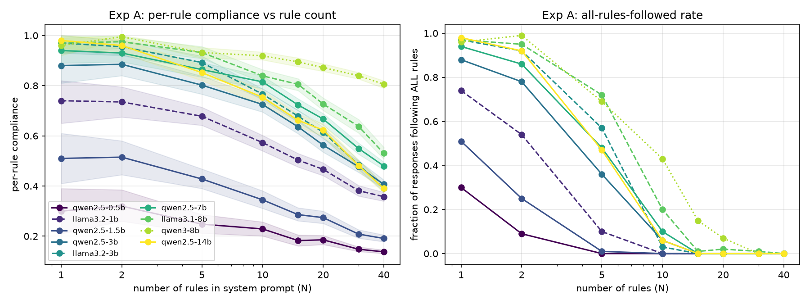
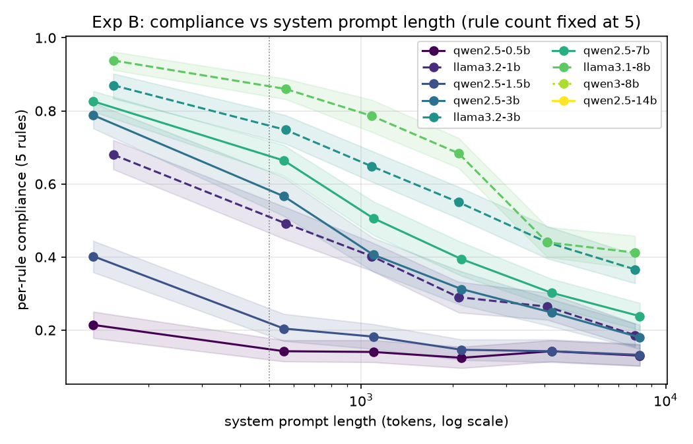
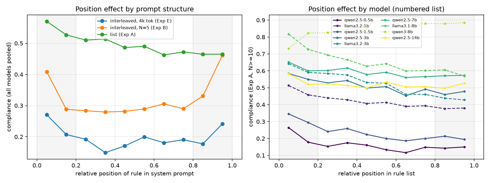
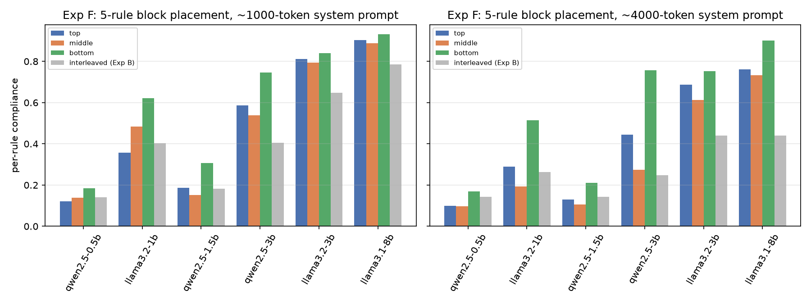
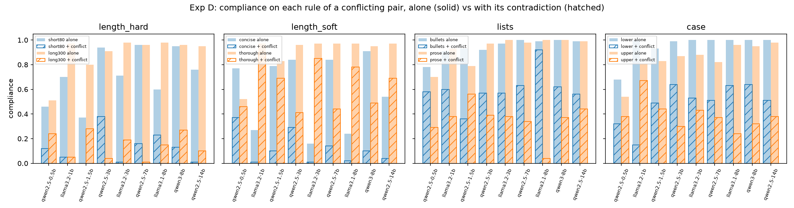

# System Prompt Saturation: When Longer Instructions Decrease Compliance

## 1. Executive Summary

**Question.** How does compliance with individual system-prompt rules change with (a) system-prompt length,
(b) number of rules, (c) where a rule sits in the prompt, and (d) contradictory rules? Does the "saturation point"
depend on model size?

**Answer.** We ran 9 open instruction-tuned models (0.5B–14.7B; Qwen2.5, Llama-3.x, Qwen3) on 40 automatically
checkable rules and 4 contradictory pairs. That came to 28,500 generations and 256,500 scored rule instances.
Each of the four claims came out differently:

1. **Length (H1): the direction is right but the effect is 3–6× larger than claimed.** We kept the rule count
   fixed at 5 and padded the prompt with neutral reference text. Per-rule compliance then fell by **7.7 pp per
   doubling** beyond 500 tokens, averaged over 7 models (95% CI 7.1–8.3), which is about **15% relative per
   doubling**; the hypothesis said 2–5%. For models that are competent at short lengths the drop was 8–12.5 pp per
   doubling. Qwen2.5-7B went from 0.83 with no padding to 0.24 at about 8k tokens. Most of this is about **where
   the rules sit relative to the end of the prompt**, not raw length. When the same 5 rules were one block at the
   *bottom* of a 4k-token prompt, right before the user turn, compliance was **+21 pp** above the same block in the
   middle and +14 pp above the top (Exp F). A contiguous block anywhere also beat the same rules scattered through
   the text.
2. **Position (H2): only partly supported, and it depends on structure.** In a numbered rule list there is a
   *primacy* effect: the first 20% of rules get about +5 pp (≈ +10% relative). The last 20% get **no** benefit and
   are slightly worse (−2.8 pp). The edges-vs-middle ratio is only 1.04 (CI 1.02–1.06), far below the predicted
   1.15–1.25. When rules are scattered through long text, both edges benefit and the end benefits most
   (ratio 1.36, CI 1.23–1.49), which matches or exceeds the hypothesis. Models differ: Qwen3-8B shows *recency*
   in lists, not primacy.
3. **Conflicts (H3): the direction is right but the magnitude is 1.5–3× larger.** Adding the contradicting rule cut
   compliance on each member of a pair by **30–83% relative** (pooled over 9 models; every one p < 1e-10, McNemar).
   The hypothesis said 20–30%. Models seldom fail gracefully. For "under 80 words" vs "at least 300 words", 58–90%
   of responses **satisfied neither**: they compromised at about 100–200 words. The drop is lopsided:
   "be concise" lost 80% of its compliance while "explain thoroughly" lost only 30%. Rules that weren't part of
   the conflict were barely affected.
4. **Saturation by size (H4): not supported as stated.** No model has a sharp knee. Per-rule compliance starts
   falling at N = 5 for every model and keeps falling roughly log-linearly up to N = 40. Larger models degrade more
   slowly, but size alone doesn't predict it:
   - 7–8B models keep 84–85% of their (chance-corrected) single-rule compliance at 10 rules and 67–72% at 20.
   - Sub-3B models keep 58–73% at 10 rules and 36–56% at 20.
   - Qwen2.5-14B is no better than Qwen2.5-3B/7B (74% retained at 10 rules).
   - Qwen3-8B is in a class of its own: 0.92 per-rule compliance at 10 rules and 0.80 at 40.

**Practical implication.** Every rule you add costs something, from the very first one. The cost grows with how far
a rule sits from the end of a long prompt. Contradictory instructions are expensive and usually end in a
compromise that satisfies neither. Putting the critical rules in a block at the **end** of a long system prompt was
the single most effective mitigation we measured.

## 2. Research Question & Motivation

Hypothesis as given:
- H1: compliance per rule drops 2–5% for each doubling of system-prompt length beyond 500 tokens;
- H2: rules in the first and last 20% of the prompt are followed 15–25% more often than middle rules;
- H3: adding conflicting rules (e.g. "be concise" + "explain thoroughly") drops compliance on both by 20–30%;
- H4: sub-3B models hit saturation at 10 rules while 7B+ models sustain up to 20 before degrading.

**Why it matters.** Deployed system prompts often run to thousands of tokens and dozens of rules: persona,
formatting, safety, tool policy and reference material. Prompt authors need to know how many rules a model can
carry, where to put the important ones, and what contradictions cost.

**Gap.** The resource-gathering stage left no literature review or papers in this workspace, so the context below
comes from background knowledge. IFEval (Zhou et al., 2023) scores 1–3 verifiable instructions in the *user* turn.
"Curse of instructions" / ManyIFEval (Harada et al., 2024) shows the all-instructions-followed rate falls with
instruction count. "Lost in the Middle" (Liu et al., 2023) documents U-shaped position effects for *retrieval*.
FollowBench and ComplexBench add constraints step by step. None of these separates length, rule count, rule
position and conflicts in the **system prompt** under a paired design with per-rule, chance-corrected metrics
across a range of model sizes. This study does.

## 3. Experimental Setup

### Models
All models ran locally with vLLM 0.32 using greedy decoding (temperature 0), max 1,024 new tokens, each model's own
chat template, and seed 42. There were no API keys on this host, so commercial models could not be tested.

| name | checkpoint | params | precision |
|---|---|---|---|
| qwen2.5-0.5b | Qwen/Qwen2.5-0.5B-Instruct | 0.5B | bf16 |
| llama3.2-1b | unsloth/Llama-3.2-1B-Instruct | 1.2B | bf16 |
| qwen2.5-1.5b | Qwen/Qwen2.5-1.5B-Instruct | 1.5B | bf16 |
| qwen2.5-3b | Qwen/Qwen2.5-3B-Instruct-AWQ | 3.1B | AWQ int4 |
| llama3.2-3b | AMead10/Llama-3.2-3B-Instruct-AWQ | 3.2B | AWQ int4 |
| qwen2.5-7b | Qwen/Qwen2.5-7B-Instruct | 7.6B | bf16 |
| llama3.1-8b | hugging-quants/Meta-Llama-3.1-8B-Instruct-AWQ-INT4 | 8.0B | AWQ int4 |
| qwen3-8b | Qwen/Qwen3-8B-AWQ (thinking disabled) | 8.2B | AWQ int4 |
| qwen2.5-14b | Qwen/Qwen2.5-14B-Instruct-AWQ | 14.7B | AWQ int4 |

AWQ checkpoints were used where shared-GPU memory (≈5–13 GB slices) left no room for bf16. This mixes quantization
with model size; see Limitations.

### Materials
- **User queries.** 100 open-ended Alpaca-cleaned instructions with no input field, filtered to
  "Explain/Describe/What/How…" requests that have no length or format constraints of their own (`data/queries.json`).
  Query *i* is used for item *i* in **every** condition, so all comparisons are paired.
- **Rule bank** (`src/rules.py`): 40 rules that can all be satisfied at once, each with a deterministic checker.
  - Start/end phrase (2).
  - Keyword or phrase inclusion (≈20; e.g. mention "Zanzibar", "Fun fact:", "#StaySharp", the year 2031).
  - Formatting (bold, `##` heading, numbered list, table, code block, quotation, [1]-style citation, URL).
  - Punctuation (emoji, semicolon, question).
  - Exclusions (no "!", no "very", "really", "however").
- **Conflict pairs** (used only in Exp D):
  - `length_hard`: "<80 words" vs "≥300 words".
  - `length_soft`: "Be concise." (<150 words) vs "Explain thoroughly, with detail and examples." (≥250 words).
  - `lists`: "bulleted list" vs "never use lists".
  - `case`: "all lowercase" vs "all UPPERCASE" (≥97% of letters).
- **Padding.** WikiText-103 validation paragraphs, introduced as "Reference material (background only)". They are
  neutral to every rule and drawn at random for each item.

### Experiments (3,600 prompts per model; `src/build_prompts.py`, seed 42)
| exp | manipulation | cells × items |
|---|---|---|
| A (count) | N ∈ {0,1,2,5,10,15,20,30,40} rules as a numbered list (prompt 6–572 tokens) | 9×100 |
| B (length) | N=5 rules, each a separate "Response rule:" paragraph inserted at random paragraph boundaries in padding; padding ∈ {0,0.5k,1k,2k,4k,8k} tokens | 6×100 |
| D (conflict) | 4 background keyword rules + {X + filler rule, Y + filler rule, X + Y}; same order skeleton | 4 pairs×3×100 |
| E (count at length) | N ∈ {10,20,40} interleaved in ~4k tokens of padding | 3×100 |
| F (block placement) | 5 rules as one numbered block at the top / middle / bottom of ~1k or ~4k tokens of padding | 6×100 |

Rule subsets and order are drawn at random for each item, so a rule's relative position is randomized
independently of its identity. N = 0 gives each model's **base rate** for every rule, i.e. how often the response
satisfies it unprompted. Exp E and Exp F were added after the first model (Qwen2.5-7B) had run A/B/D. They use
separate RNG streams, so A/B/D prompts are byte-identical across models (this was checked).

### Metrics and statistics
- **Per-rule compliance**: the fraction of (response, rule) pairs where the checker passes. Also reported:
  - the all-rules-followed rate;
  - chance-corrected retention, (c(N) − base) / (c(1–2) − base).
- **CIs**: item-clustered bootstrap over the 100 queries, 2,000 resamples.
- **Regressions**: linear probability models with rule fixed effects (and model/condition fixed effects where
  pooled), using cluster-robust standard errors by item.
  - H1 slope: on log2(prompt tokens).
  - H2: position bins first 20% / middle / last 20%.
- **H3**: paired McNemar (exact binomial) tests, alone vs with the conflict; Holm correction across the 72
  model × pair × rule tests and across the H1 per-model slopes.

### Compute
- 4× RTX A6000 (48 GB), shared with other users. We had one ~40 GB slice at the start and 5–13 GB slices after.
- About 4.5 hours of generation in total. Wall-clock time per model ran from 20 min (0.5B) to over 2 h (8B AWQ on
  a contended GPU with a 3.5 GB KV cache).
- Because of contention, **not every model finished every experiment**:

| experiment | models with complete data |
|---|---|
| A | all 9 |
| D | all 9 |
| B | 7: not qwen3-8b, qwen2.5-14b |
| E, F | 6: not qwen2.5-7b, qwen3-8b, qwen2.5-14b |

## 4. Results

All tables are in `results/tables/`, figures in `figures/`, and the full printed analysis is in
`results/analysis_output.txt`.

### 4.1 Exp A — rule count (H4)

Per-rule compliance (rules as a numbered list):

| N | q0.5b | l1b | q1.5b | q3b | l3b | q7b | l8b | qwen3-8b | q14b |
|---|---|---|---|---|---|---|---|---|---|
| 1 | .30 | .74 | .51 | .88 | .97 | .94 | .97 | .96 | .98 |
| 5 | .25 | .68 | .43 | .80 | .89 | .86 | .93 | .93 | .85 |
| 10 | .23 | .57 | .35 | .73 | .77 | .82 | .84 | **.92** | .75 |
| 20 | .19 | .47 | .27 | .56 | .61 | .67 | .73 | **.87** | .62 |
| 40 | .14 | .36 | .19 | .41 | .39 | .48 | .53 | **.80** | .39 |

Chance-corrected retention relative to N = 1–2 (`expA_saturation.csv`):

| model | size | ret. N=10 | ret. N=20 | ret. N=40 | first N with retention < 90% |
|---|---|---|---|---|---|
| qwen2.5-0.5b | <3B | 0.59 | 0.36 | 0.12 | 5 |
| llama3.2-1b | <3B | 0.73 | 0.56 | 0.37 | 5 |
| qwen2.5-1.5b | <3B | 0.58 | 0.39 | 0.19 | 5 |
| qwen2.5-3b | 3B | 0.79 | 0.58 | 0.37 | 5 |
| llama3.2-3b | 3B | 0.77 | 0.59 | 0.31 | 5 |
| qwen2.5-7b | ≥7B | 0.85 | 0.67 | 0.43 | 5 |
| llama3.1-8b | ≥7B | 0.84 | 0.72 | 0.47 | 10 |
| qwen3-8b | ≥7B | **0.93** | **0.89** | **0.80** | **20** |
| qwen2.5-14b | ≥7B | 0.74 | 0.60 | 0.31 | 5 |

- Hinge regressions find no consistent knee; the best breakpoints are scattered between 5 and 30 rules.
- The "all rules followed" rate collapses to ≈0 by N = 15 for every model except Qwen3-8B (0.15 at N = 15).
- **Length is confounded with count in Exp A** (40 rules ≈ 570 tokens). Exp E holds length at ~4k tokens instead.
  There, compliance still falls with N for all 6 models that ran it. For N = 5/10/20/40:
  - Llama-3.1-8B: 0.44 → 0.39 → 0.32 → 0.27
  - Llama-3.2-3B: 0.44 → 0.38 → 0.30 → 0.24
  - Qwen2.5-3B: 0.25 → 0.21 → 0.19 → 0.18
  
  The slope is flatter than in Exp A because the 4k padding has already pushed compliance toward the floor
  (`expE_count_at_4k.csv`, `figures/expE_count_long.png`).

**Verdict on H4:** not supported as stated. Only one 7B+ model (Qwen3-8B) comes close to the "sustains up to
~20 rules" pattern: it keeps ≥90% retention through N = 15 and 0.89 at N = 20. The other three 7B+ models, like the
small ones, fall below 90% retention by N = 5–10. There is no saturation knee at 10 for small models. Degradation is gradual from N ≈ 5 for every model. Bigger models do retain
more, but within-family size ordering is not monotone (Qwen2.5-14B < 7B), and the model family/generation
(Qwen3-8B) matters more than parameter count.

### 4.2 Exp B — length with rule count fixed at 5 (H1)

| padding (≈ total tokens) | q0.5b | l1b | q1.5b | q3b | l3b | q7b | l8b |
|---|---|---|---|---|---|---|---|
| 0 (~110) | .21 | .68 | .40 | .79 | .87 | .83 | .94 |
| 500 (~530) | .14 | .49 | .20 | .57 | .75 | .66 | .86 |
| 1000 | .14 | .40 | .18 | .41 | .65 | .51 | .79 |
| 2000 | .12 | .29 | .15 | .31 | .55 | .39 | .68 |
| 4000 | .14 | .26 | .14 | .25 | .44 | .30 | .44 |
| 8000 | .13 | .19 | .13 | .18 | .37 | .24 | .41 |

Slope per doubling of prompt length, ≥500 tokens only (rule fixed effects, item-clustered; `expB_slopes.csv`):

| model | pp / doubling [95% CI] | relative / doubling | Holm p |
|---|---|---|---|
| qwen2.5-0.5b | −0.6 [−1.1, −0.1] | −4% (floor) | 0.02 |
| llama3.2-1b | −8.0 [−9.1, −6.9] | −16% | <1e-30 |
| qwen2.5-1.5b | −2.4 [−3.1, −1.6] | −12% | <1e-9 |
| qwen2.5-3b | −10.0 [−11.2, −8.8] | −18% | <1e-50 |
| llama3.2-3b | −9.7 [−10.9, −8.5] | −13% | <1e-50 |
| qwen2.5-7b | −11.0 [−12.0, −9.9] | −17% | <1e-80 |
| llama3.1-8b | −12.5 [−13.7, −11.4] | −15% | <1e-90 |
| **pooled (7 models)** | **−7.7 [−8.3, −7.1]** | **−15%** | 2e-149 |

**Verdict on H1:** the direction holds but the size is wrong. The decline is 3–6× steeper than 2–5% per doubling.
It also starts *before* 500 tokens: the 0 → 500-token step alone costs 8–22 pp in competent models. The tiny
models (0.5B, 1.5B) are already near their base rate with no padding, so their slopes are small.

### 4.3 Position (H2), and Exp F: block placement

Compliance by relative position, pooled over models, with rule and condition fixed effects (`position.csv`):

| structure | first 20% | middle | last 20% | (first+last)/2 ÷ middle [95% CI] | first vs mid | last vs mid |
|---|---|---|---|---|---|---|
| numbered list (Exp A, N≥10) | .550 | .489 | .465 | **1.04 [1.02, 1.06]** | +5.0 pp*** | −2.8 pp*** |
| interleaved, N=5 (Exp B, ≥1k) | .365 | .287 | .412 | **1.36 [1.23, 1.49]** | +7.1 pp*** | +9.4 pp*** |
| interleaved, ~4k (Exp E) | .239 | .180 | .212 | 1.25 [1.15, 1.35] | +6.0 pp*** | +4.9 pp*** |

How models differ in the numbered-list format:
- In 8 of 9 models the first 20% gain +3 to +13 pp and the last 20% lose 0 to −9 pp.
  - Llama-3.1-8B has the strongest primacy effect: +12.8 pp for the first 20%, −5.2 pp for the last 20%.
  - Llama-3.2-3B: +8.7 pp for the first 20%, −9.3 pp for the last 20%.
- Qwen3-8B is the reverse: the first 20% are −8.7 pp and the last 20% are +2.1 pp.

**Exp F (the same 5 rules as one block, varying only where the block sits)**, pooled over models
(`expF_place_tests.csv`, rule and model fixed effects):

| prompt length | top vs middle | bottom vs middle |
|---|---|---|
| ~1k tokens | +1.7 pp (p = 0.11) | **+11.0 pp** [8.9, 13.1] |
| ~4k tokens | +6.3 pp [4.1, 8.4] | **+20.8 pp** [18.6, 23.0] |

Pooled compliance at ~4k tokens, ordered from best to worst:
- block at the bottom: 0.55
- block at the top: 0.40
- block in the middle: 0.34
- the same 5 rules scattered through the text (Exp B): 0.28

Some individual models:
- **Qwen2.5-3B:** 0.76 at the bottom, 0.27 in the middle, 0.44 at the top. Its no-padding score is 0.80, so a
  bottom block almost fully recovers.
- **Llama-3.1-8B:** 0.90 at the bottom, 0.73 in the middle, 0.76 at the top, but only 0.44 when the rules are
  interleaved.

Two separate things drive the "length" penalty in Exp B:
1. **Distance from the end of the prompt.** A block right before the user turn is followed most often.
2. **Scattering the rules among unrelated text.** A contiguous block beats interleaved rules at every
   placement, and especially for Llama models.

**Verdict on H2:** mixed.
- In plain rule lists the edge advantage is small (≈4% relative) and comes only from the first rules. The last
  rules are slightly *worse*, so the predicted 15–25% gain does not appear.
- When rules are embedded in long text, the effect is U-shaped with the strongest effect at the end (38% relative),
  which meets or exceeds the hypothesis.
- For whole blocks, end placement dominates: +11 to +21 pp over the middle.

### 4.4 Exp D — conflicting rules (H3)

Pooled over 9 models (n = 900 paired items per row; `expD_conflict.csv`):

| pair | rule | alone | with its contradiction | relative change [95% CI] |
|---|---|---|---|---|
| length_hard | <80 words | .72 | .12 | −83% [−87, −79] |
| length_hard | ≥300 words | .89 | .15 | −83% [−87, −80] |
| length_soft | be concise (<150 w) | .60 | .12 | −80% [−84, −75] |
| length_soft | explain thoroughly (≥250 w) | .90 | .63 | **−30%** [−35, −25] |
| lists | bulleted list | .94 | .60 | −36% [−43, −29] |
| lists | no lists | .93 | .35 | −62% [−68, −55] |
| case | all lowercase | .96 | .49 | −49% [−53, −44] |
| case | ALL UPPERCASE | .85 | .39 | −54% [−58, −49] |

All rows have p < 1e-10 (McNemar). After Holm correction, 66 of the 72 per-model tests remain significant.

How models resolve the conflict (`expD_winner.csv`; "both" is impossible for these pairs):
- **Length conflicts usually end in a compromise that satisfies neither rule.** For `length_hard`, "neither" ranges
  from 58% (Qwen2.5-3B) to 90% (Llama-3.2-1B). Median length with both rules is 96–220 words, against ~50–90 for
  the short rule alone and ~350–500 for the long rule alone (`expD_wordcounts.csv`).
- **Format and case conflicts usually get resolved: one rule wins.** "Neither" is only 0–13% in 8 of the 9 models.
  - The rule that wins is model-specific and stable: Llama-3.1-8B picks bullets 92% of the time.
  - The *later* rule in the list does not systematically win; its order was randomized.
- **The soft-length conflict is lopsided.** Every model leans toward "thorough": "concise" loses 80%, "thorough"
  loses 30%. The 30% figure is the only one inside the hypothesized 20–30% band.
- **Little effect on the other rules.** Background keyword rules move by only ≈0–8 pp between conflict and
  no-conflict conditions, with no consistent sign (`expD_background.csv`).

**Verdict on H3:** the direction holds, but the magnitude is 1.5–3× larger than the predicted 20–30%. For
mutually exclusive rules, at most one can be followed, so a large drop is guaranteed. The informative results are
that models often satisfy *neither* rule (for length) and that for soft conflicts the "thorough" instruction
reliably wins.

### 4.5 Qualitative error analysis
- **Long prompts → rules silently dropped.** At 8k tokens, Qwen2.5-7B gives a well-formed, on-topic answer that
  ignores most rules: emoji, "gracias", "velvet" and code block are missing, while bold survives
  (`B|L8000|5`). It does not get confused by the padding; it just behaves as if the rules weren't there.
  - Rules that are naturally common survive: bold, numbered lists, the exclusion rules.
  - Arbitrary keywords die first: "velvet", "pineapple", "indeed ×2" and "consequently" all reach ≈0 at 4–8k
    (per-rule breakdown in `results/rule_scores.parquet`).
- **Conflict compromises.** Given "<80 words" + "≥300 words", Qwen2.5-7B wrote 143 words. Given "lowercase" +
  "UPPERCASE" plus a "gracias" keyword rule, it wrote "orion" in lowercase and then switched to an **all-caps
  Spanish answer**. Satisfying one rule bled into a strange interpretation of another.
- **Exclusion rules carry no signal.** Exclusion rules ("never use *really*") have base rates of 81–99%, so they
  look "followed" no matter what. All headline effects are driven by the inclusion and format rules. The
  chance-corrected retention metric accounts for this.

### 4.6 Reproducibility check
Qwen2.5-1.5B was re-run on all of Exp A (900 prompts, 12,300 rule checks) in a separate process on a different GPU,
with a different KV-cache size and therefore different batching. Prompts and greedy decoding were identical.
- Only **13% of responses were byte-identical**, because vLLM greedy decoding is not batch-invariant and small
  numeric differences change the text.
- Even so, **93.7% of individual rule checks agreed**, and mean compliance was 0.2503 vs 0.2496 (**−0.07 pp**).
  See `results/rerun_check.txt`.

Aggregate effects are therefore stable against decoding noise, but no single response should be treated as
deterministic.

## 5. Discussion

- **The rule-count curve is smooth, not a cliff.** Even the best model loses compliance from the second rule
  onward. The hypothesis pictured a capacity that fills up (saturation at 10 or 20 rules). What we see looks more
  like attention being diluted: each additional rule or each additional 1k tokens of distance lowers the
  probability that any given rule shapes the output. Model quality sets the *level* and the *rate*, but no tested
  model is flat to 20 rules. Qwen3-8B comes closest (0.92 → 0.87 from 10 to 20 rules), which suggests newer
  instruction-tuning recipes matter more than raw scale. Qwen2.5-14B (AWQ) did *not* beat Qwen2.5-7B (bf16). This
  could be a quantization effect (Limitations), but it fits the view that scale alone does not buy rule capacity.
- **Length hurts through distance and burial.** Comparing Exp B and Exp F, the same 5 rules in a 4k-token prompt
  are followed (pooled over 6 models):
  - 28% of the time when scattered;
  - 34% as a block in the middle;
  - 40% as a block at the top;
  - 55% as a block at the bottom, next to the user turn. Chat models seem to weight the most recent system text heavily
  when deciding output format and content. For plain short lists, though, the first rules win. These two
  findings reconcile through prompt length: in a short list every rule is close to the end, so the order effect
  is primacy; in a long prompt, distance from the end dominates.
- **Conflicts are worse than the hypothesis expected.** "Neither" outcomes (compromises) are common for numeric
  constraints, so a contradictory pair can do worse than dropping one of the two rules.

## 6. Limitations

- **Open models only.** There were no API keys, so we could not test GPT/Claude/Gemini. Frontier models may be much
  more robust; Qwen3-8B already is.
- **Quantization is confounded with size.** The 3B, 8B and 14B models are AWQ int4 while 0.5B–1.5B and 7B are
  bf16. The 14B < 7B result in particular could partly reflect AWQ.
- **Incomplete coverage.** Not every model ran every experiment (see Setup).
  - Exp B covers 7 models.
  - Exp E and F cover 6 models (0.5B–3B plus Llama-3.1-8B).
  - Qwen3-8B and Qwen2.5-14B have only Exps A and D.
- **Artificial rules.** The rules are synthetic and verifiable: arbitrary keywords and formats. Real system-prompt
  rules (tone, refusals, tool policy) may behave differently. Inclusion rules are harder than "natural" rules, and
  exclusion rules are near ceiling.
- **Padding choice.** The padding is encyclopedic text labelled as background. Realistic padding such as tool
  documentation or policies might compete with rules more, or less.
- **Exp A confound.** In Exp A, count and length go up together (40 rules ≈ 570 tokens). Exp E addresses this only
  for models that ran it.
- **One pass per model.** Each model was run once with greedy decoding. Run-to-run variance from batch
  non-invariance was checked on one model only. The CIs cover query sampling, not decoding noise.
- **Single-query responses.** We tested only single-turn, ~100–500-word answers; multi-turn dynamics were not
  tested.

## 7. Conclusions & Next Steps

System-prompt compliance degrades **continuously**. We measured about −7 pp (≈−15% relative) per doubling of
prompt length at a fixed rule count, a steady decline with every rule added, and 30–83% losses when rules
contradict. That is steeper than all four hypothesized magnitudes. The predicted size thresholds (10 vs 20 rules)
did not appear. Model recipe (Qwen3) mattered more than parameter count. The most actionable finding is
placement: in long system prompts, **put the rules that must be followed in one block at the end**. In short rule
lists, put the most important rules first.

Follow-ups:
1. Repeat with frontier API models and bf16 versions of the 3B/8B/14B models.
2. Use realistic rule types (tone, refusal, tool-use policies) judged by an LLM.
3. Cross placement × count × length fully, including "repeat the critical rules at the end".
4. Run multi-turn sessions to see whether compliance decays over turns.
5. Test whether explicit priority markers ("MOST IMPORTANT") or a stated conflict-resolution order fix the
   both-fail compromises.

## References
- Zhou et al. (2023). *Instruction-Following Evaluation for Large Language Models* (IFEval).
- Harada et al. (2024). *Curse of Instructions: Large Language Models Cannot Follow Multiple Instructions at Once.*
- Liu et al. (2023). *Lost in the Middle: How Language Models Use Long Contexts.*
- Jiang et al. (2023). *FollowBench*; Wen et al. (2024). *ComplexBench.*
- Data: yahma/alpaca-cleaned; Salesforce/wikitext (WikiText-103). Tools: vLLM 0.32, PyTorch 2.13, transformers
  5.19, pandas 3.1, statsmodels 0.15, SciPy 1.18, Python 3.12.
